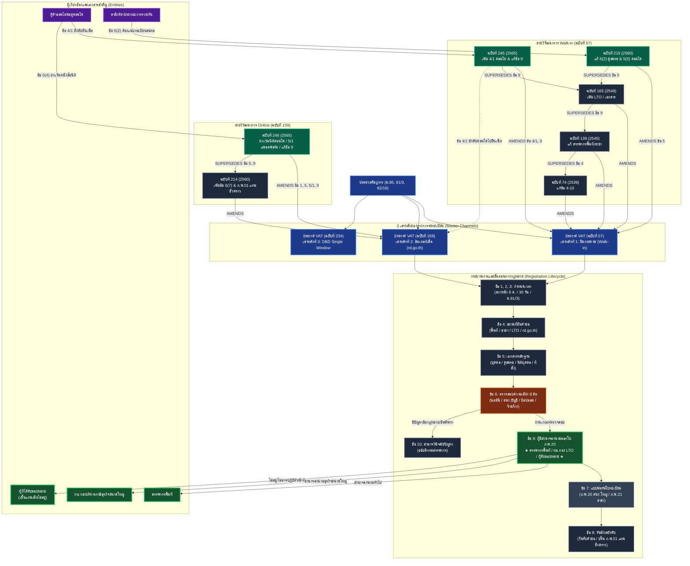

# แผนผังความสัมพันธ์โครงสร้าง Graph RAG การจดทะเบียนภาษีมูลค่าเพิ่ม
*(VAT Registration Multi-Dimensional Knowledge Graph & Relationship Architecture)*

---

## 1. บทนำและภาพรวมเชิงสถาปัตยกรรม (System Overview)

ในการพัฒนาระบบสืบค้นอัจฉริยะ (RAG) สำหรับการจดทะเบียนภาษีมูลค่าเพิ่ม ปัญหาที่พบบ่อยที่สุดคือ **"การดึงข้อมูลผิดข้อ (Retrieval Mismatch)"** อันเกิดจากความชนกันของคำสำคัญ (Semantic Collision) เช่น คำถามเรื่อง *"ถ้าสรรพากรไม่อยู่ใครเซ็น ภ.พ.20"* มักถูกคำว่า *"ภ.พ.20"* ดึงไปที่ **ข้อ 7** (ซึ่งเป็นเพียงข้อกำหนดแบบพิมพ์) แทนที่จะไปที่ **ข้อ 9** (ซึ่งเป็นข้อกำหนดผู้มีอำนาจลงนามและผู้รับมอบหมาย) ส่งผลให้ LLM เกิดอาการมโน (Hallucination)

การสร้าง **Graph RAG (Knowledge Graph Enhanced Retrieval)** จึงทำหน้าที่เป็นโครงข่ายความสัมพันธ์หลายมิติ (Multi-Dimensional Knowledge Graph) เชื่อมโยง:
1. **สายวิวัฒนาการกฎหมาย (Legal Lineage)**: การแก้ไขเพิ่มเติม (AMENDS) และการแทนที่ (SUPERSEDES) ของประกาศทั้ง 10 ฉบับ
2. **ขั้นตอนการดำเนินงาน (Process Lifecycle)**: ตั้งแต่คุณสมบัติผู้ขอ -> กำหนดเวลา -> ช่องทางยื่น -> เอกสาร -> การตรวจสอบความเสี่ยง -> การลงนาม -> วันมีผล
3. **ผังอำนาจและเอกสาร (Entities & Authority)**: สรรพากรพื้นที่, ผอ.กอง LTO, ผู้รับมอบหมาย, นิติคอนโด, แพลตฟอร์ม e-Marketplace

---

## 2. แผนผังความสัมพันธ์ภาพรวม (Master Relationship Graph)

---

## 3. ตารางความสัมพันธ์เชิงหน้าที่ (Entity-Relationship & Semantic Matrix)

| หมวดหมู่ความสัมพันธ์ | โหนดต้นทาง (Source) | ความสัมพันธ์ (Edge Type) | โหนดปลายทาง (Target) | สาระสำคัญทางกฎหมายและผลต่อ RAG |
| :--- | :--- | :--- | :--- | :--- |
| **สายวิวัฒนาการกฎหมาย** | ประกาศฯ ฉบับที่ 245 | `AMENDS` / `SUPERSEDES` | ฉบับที่ 57 (ข้อ 4/1, 9) | ยกเลิกข้อความเดิมของข้อ 9 และบังคับใช้ตัวบทใหม่ปี 2565 |
| **สายวิวัฒนาการกฎหมาย** | ประกาศฯ ฉบับที่ 246 | `AMENDS` / `SUPERSEDES` | ฉบับที่ 159 (ข้อ 5, 5/1, 9) | ยกเว้นหนังสือนิติคอนโด เพิ่มการยินยอมแพลตฟอร์ม และข้อ 9 ปัจจุบัน |
| **สายวิวัฒนาการกฎหมาย** | ประกาศฯ ฉบับที่ 215 | `AMENDS` / `SUPERSEDES` | ฉบับที่ 57 (ข้อ 5(2), 5(5)(ก)) | บังคับแนบทะเบียนสมรส และต้องมีหนังสือนิติคอนโด (สำหรับการยื่น Walk-in) |
| **ข้ามช่องทาง (Cross-Channel)** | ผู้ค้าออนไลน์คอนโด | `REQUIRES_ONLINE_ONLY` | rd.go.th (ฉบับ 159/246) | ประกาศ 245 ข้อ 4/1 บังคับยื่นอินเทอร์เน็ต ห้ามยื่น Walk-in |
| **ข้อยกเว้นพิเศษ (Exemption)** | ผู้ค้าออนไลน์คอนโด | `EXEMPTS_DOC` | หนังสือนิติบุคคลอาคารชุด | ประกาศ 246 ข้อ 5(4) วรรคท้าย ให้สิทธิไม่ต้องขอหนังสือนิติคอนโด |
| **อำนาจลงนาม (Authority)** | คำร้องที่ผ่านการตรวจ | `AUTHORIZES_SIGNING` | สรรพากรพื้นที่ / ผอ.กอง LTO | ข้อ 9 ระบุผู้มีอำนาจลงนามโดยตรง 2 ตำแหน่ง |
| **การปฏิบัติแทน (Delegation)** | ผู้มีอำนาจไม่อยู่ | `AUTHORIZES_DELEGATE` | ผู้ที่ได้รับมอบหมาย | กฎหมายระบุคำว่า *"หรือผู้ที่ได้รับมอบหมาย"* รองรับการเซ็นแทน |
| **สกัดกั้นการชนคำ (Anti-Collision)** | คำถาม *"ใครเซ็น/ไม่อยู่"* | `SUPPRESS_COLLISION` | ข้อ 7 (แบบพิมพ์ ภ.พ.20) | ลดคะแนน -0.60 เพื่อป้องกันไม่ให้ดึงข้อ 7 มาตอบแทนข้อ 9 |

---

## 4. สรุปจุดชี้ขาดทางกฎหมาย (Ground Truth Resolutions)

### จุดที่ 1: ผู้มีอำนาจลงนาม ภ.พ.20 (ข้อ 9 vs ข้อ 7 vs ข้อ 10)
- **ข้อ 9 (ตัวบทแท้จริง)**: บัญญัติเรื่อง *"ผู้มีอำนาจออกใบทะเบียนภาษีมูลค่าเพิ่ม"* โดยตรง ได้แก่:
  1. **สรรพากรพื้นที่** หรือผู้ที่สรรพากรพื้นที่มอบหมาย
  2. **ผู้อำนวยการกองบริหารภาษีธุรกิจขนาดใหญ่** หรือผู้ที่ผู้อำนวยการกองบริหารภาษีธุรกิจขนาดใหญ่มอบหมาย
  - *กรณีไม่อยู่*: กฎหมายเขียนรองรับสิทธิ์การมอบหมาย (หรือผู้ปฏิบัติราชการแทนตาม พ.ร.บ.ระเบียบบริหารราชการแผ่นดิน) ไว้อย่างชัดเจน
- **ข้อ 7 (ข้อที่มักเข้าใจผิด)**: เป็นเรื่อง *"การออกใบทะเบียนภาษีมูลค่าเพิ่ม ให้ใช้แบบ ภ.พ.20 และ ภ.พ.21"* (เป็นข้อกำหนดแบบพิมพ์ฟอร์ม ไม่ได้กำหนดผู้มีอำนาจลงนาม)
- **ข้อ 10 (อำนาจวินิจฉัย)**: เป็นเรื่อง *"ในกรณีที่มีปัญหาในการปฏิบัติ ให้อธิบดีกรมสรรพากรมีอำนาจวินิจฉัย"* (เป็นอำนาจชี้ขาดปัญหากฎหมาย มิใช่อำนาจเซ็นใบ ภ.พ.20)

### จุดที่ 2: การจดทะเบียนของผู้ค้าออนไลน์ที่พักอาศัยคอนโด
- **ประกาศฯ ฉบับที่ 245 ข้อ 4/1**: บังคับให้บุคคลธรรมดาสัญชาติไทยที่เป็นผู้ค้าออนไลน์และใช้ห้องชุดเป็นที่ตั้งสถานประกอบการ **ต้องยื่นคำขอผ่านระบบเครือข่ายอินเทอร์เน็ตที่ rd.go.th เท่านั้น**
- **ประกาศฯ ฉบับที่ 246 ข้อ 5(4) วรรคท้าย**: ให้สิทธิพิเศษ **ไม่ต้องแนบหนังสือรับรองจากนิติบุคคลอาคารชุด** โดยแนบเพียงสัญญาเช่า/หนังสือยินยอม และทะเบียนห้องชุด

### จุดที่ 3: เกณฑ์คัดกรองความเสี่ยง 8 ประการตามข้อ 6 (Agent 6)
เจ้าพนักงานสรรพากรมีอำนาจ **ไม่ออกใบทะเบียน ภ.พ.20** หากพบข้อเท็จจริงดังต่อไปนี้:
1. แสดงรายการในคำขอเป็นเท็จ
2. เป็นตัวแทนเชิด (นอมินี / ลูกจ้างเป็นกรรมการ)
3. ไม่มีสถานประกอบการจริงตามที่ระบุ
4. ใช้ที่ตั้งสำนักงานบัญชีหรือสำนักงานกฎหมายเป็นสถานประกอบการ
5. มิได้ประกอบกิจการจริงตามสภาพธุรกิจ
6. เคยถูกเพิกถอนการจดทะเบียน VAT มาก่อน
7. ไม่ส่งมอบเอกสารหลักฐานตามที่เจ้าพนักงานร้องขอ
8. ผู้ค้าออนไลน์ไม่อัปโหลดเอกสารผ่านระบบอินเทอร์เน็ต

---

## 5. การเปิดใช้งานตัวแสดงผล Interactive Live Viewer

ท่านสามารถเปิดไฟล์ [graph_rag_live_viewer.html](file:///C:/Users/Windows/.gemini/antigravity/scratch/chunking%20ประกาศ/graph_rag_live_viewer.html) ผ่านเว็บเบราว์เซอร์ เพื่อดูความสัมพันธ์แบบโต้ตอบได้ทันที:

- **สลับ 3 มุมมอง (Multi-View)**:
  - *🔄 ผังกระบวนการ (Process Flow)*: ดูกระบวนการตั้งแต่ผู้ขอจนถึงใบทะเบียน
  - *📜 สายวิวัฒนาการ (Lineage)*: ดูการแทนที่ของประกาศทั้ง 10 ฉบับ
  - *⚖️ จุดชี้ขาด ข้อ 9 vs 7 vs 10*: ดูการทำงานของ Anti-Collision Guardrail
- **ทดสอบคำถามจำลอง (Interactive Query Simulator)**:
  - คลิกปุ่มจำลองคำถาม เช่น *"ถ้าสรรพากรไม่อยู่ใครเซ็น ภ.พ.20"* หรือ *"จด vat ต้องเตรียมเอกสารอะไรไปยื่น"* เพื่อดูโหนดที่ระบบเปิดใช้งาน (Active Nodes) และเหตุผลการตอบของ RAG
