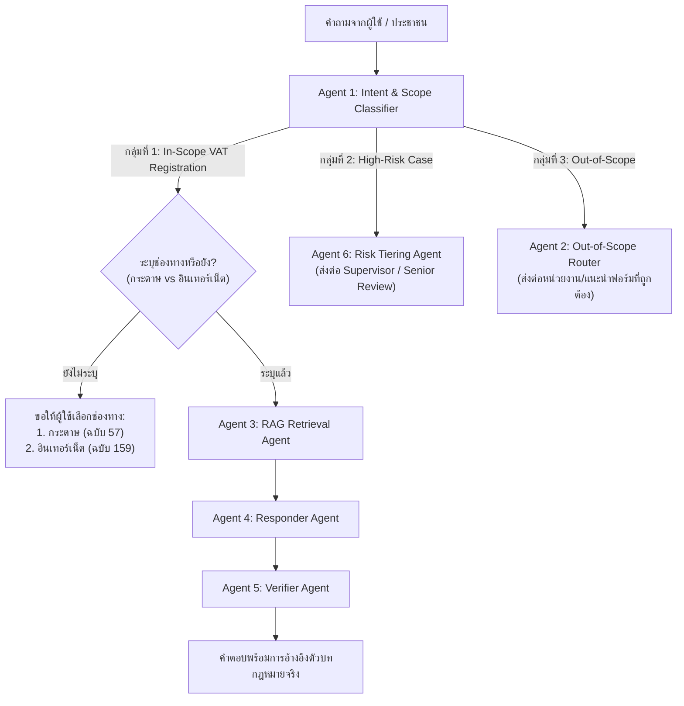

# Master System Context: VAT Co-Pilot AI (ระบบสนับสนุนงานจดทะเบียนภาษีมูลค่าเพิ่ม)

> **เอกสารอ้างอิงบริบทระบบและองค์ความรู้ทางกฎหมายภาษีอากร (System Context & Domain Knowledge Specification)**  
> **หน่วยงาน:** กรมสรรพากร (Revenue Department of Thailand)  
> **สถานะการจัดเก็บ:** Isolated Environment (Sandbox / Brain Context)

---

## 1. วัตถุประสงค์และภาพรวมโครงการ (Project Mission & Overview)

**VAT Co-Pilot AI** คือระบบผู้ช่วยอัจฉริยะ (AI Decision Support System) สำหรับเจ้าหน้าที่กรมสรรพากร เพื่อสนับสนุนการตอบข้อหารือ ตรวจสอบเอกสาร และให้คำแนะนำเกี่ยวกับการ **"ยื่นคำขอจดทะเบียนภาษีมูลค่าเพิ่ม (VAT Registration) ครั้งแรก"**

### ปัญหาหลักที่ระบบออกแบบมาเพื่อแก้ไข:
1. **Retrieval Mismatch (การดึงข้อมูลผิดข้อ):** ภาษาประชาชนเป็นภาษาพูด/คำสแลง (เช่น *"ใครเซ็น ภ.พ.20"*, *"จด vat ล่วงหน้าได้ไหม"*) ขณะที่ตัวบทกฎหมายใช้ภาษาราชการระดับสูง ส่งผลให้ Search ทั่วไปจับคู่ผิดข้อ (เช่น เอาข้อ 7 เรื่องแบบฟอร์ม หรือข้อ 4 เรื่องสถานที่ ไปตอบแทนข้อ 9 เรื่องผู้มีอำนาจลงนาม)
2. **LLM Hallucination (อาการมโนของ AI):** เมื่อ Retrieval ดึงข้อมูลผิดข้อ หรือบริบทถูกตัดทอนไม่สมบูรณ์ LLM จะสร้างคำตอบที่ไม่มีในกฎหมายจริง
3. **Scope Boundary Leakage (คำถามนอกขอบเขตหลุดเข้ามา):** คำถามเรื่องภาษีอื่น เช่น การยื่นแบบรายเดือน ภ.พ.30, การแจ้งเปลี่ยนที่อยู่ ภ.พ.09 หรือภาษีบุคคลธรรมดา ภ.ง.ด.90 หลุดเข้าไปใน RAG ทำให้ตอบผิดเพี้ยน

---

## 2. ขอบเขตกฎหมายแม่บท: 10 ประกาศอธิบดีกรมสรรพากร

ระบบยึดถือ **ประกาศอธิบดีกรมสรรพากร เกี่ยวกับภาษีมูลค่าเพิ่ม** ทั้ง 10 ฉบับเป็น Ground Truth เด็ดขาด แบ่งโครงสร้างออกเป็น 3 กลุ่ม (ตัวบทใน `chunking/` ตรวจเทียบไฟล์ต้นฉบับใน `chunking/sources/` แล้ว — ฉบับ 57 และ 159 เป็นฉบับรวมล่าสุด ฉบับแก้ไขอื่นถูกเขียนทับเข้าไปแล้ว รวมถึงฉบับระหว่างทางที่ไม่อยู่ในชุดข้อมูล เช่น 99, 203, 204):

```mermaid
graph TD
    subgraph CoreAnnouncements["2 ประกาศแม่บทหลัก"]
        VAT57["ฉบับที่ 57 (พ.ศ. 2537)<br/>ยื่นแบบกระดาษ ณ สรรพากรพื้นที่"]
        VAT159["ฉบับที่ 159 (พ.ศ. 2547)<br/>ยื่นผ่านอินเทอร์เน็ต www.rd.go.th"]
    end

    subgraph SpecialAnnouncement["1 ประกาศเฉพาะกิจ"]
        VAT234["ฉบับที่ 234 (พ.ศ. 2563)<br/>ยื่น ณ กรมพัฒนาธุรกิจการค้า (DBD)<br/>(ใช้เฉพาะคำถามมีคำว่า DBD)"]
    end

    subgraph Amendments57["ฉบับแก้ไขเพิ่มเติม ฉบับที่ 57"]
        VAT74["ฉบับที่ 74 (พ.ศ. 2539)"]
        VAT139["ฉบับที่ 139 (พ.ศ. 2545)"]
        VAT165["ฉบับที่ 165 (พ.ศ. 2549)"]
        VAT215["ฉบับที่ 215 (พ.ศ. 2560)"]
        VAT245["ฉบับที่ 245 (พ.ศ. 2565)<br/>(คอนโดออนไลน์ & อำนาจ LTO)"]
    end

    subgraph Amendments159["ฉบับแก้ไขเพิ่มเติม ฉบับที่ 159"]
        VAT214["ฉบับที่ 214 (พ.ศ. 2560)"]
        VAT246["ฉบับที่ 246 (พ.ศ. 2565)<br/>(คอนโดยื่นเน็ตวิธีเดียว & แพลตฟอร์ม)"]
    end

    VAT74 -->|แก้ไขข้อ 4, เพิ่มข้อ 5-10| VAT57
    VAT139 -->|แก้ไขข้อ 4 ว.1, ข้อ 9| VAT57
    VAT165 -->|แก้ไขข้อ 4(3), 5, 9| VAT57
    VAT215 -->|แก้ไขข้อ 5(2), 5(5)(ก)| VAT57
    VAT245 -->|เพิ่มข้อ 4/1, แก้ไขข้อ 9| VAT57

    VAT214 -->|แก้ไขข้อ 5, เพิ่มข้อ 6(7), แก้ไขข้อ 8, 9| VAT159
    VAT246 -->|เพิ่มข้อ 1 ว.2, 5/1, 6(8), แก้ข้อ 9| VAT159
```

### สรุปสาระสำคัญตามตัวบทจริง (Ground Truth Facts):

1. **ข้อ 1 (ฉบับ 57) / ข้อ 2 (ฉบับ 159) — จด VAT ล่วงหน้า:**
   * ผู้ประกอบการมีสิทธิยื่นขอจดทะเบียนล่วงหน้าได้ **ไม่เกิน 6 เดือนก่อนวันเริ่มประกอบกิจการ**
   * เงื่อนไข: ต้องมีแผนงานที่พิสูจน์ได้ว่าเตรียมการประกอบการ และมีการก่อสร้างโรงงาน อาคารสำนักงาน หรือติดตั้งเครื่องจักร
2. **ข้อ 4 (ฉบับ 57 แก้ไขโดย 139, 165) — สถานที่ยื่นคำขอแบบกระดาษ:**
   * กทม.: สำนักงานสรรพากรพื้นที่ หรือสำนักงานสรรพากรพื้นที่สาขา ในเขตที่ตั้งสถานประกอบการ
   * ต่างจังหวัด: สำนักงานสรรพากรพื้นที่สาขา ในเขตที่ตั้งสถานประกอบการ
   * รายใหญ่: สำนักบริหารภาษีธุรกิจขนาดใหญ่ (LTO)
3. **ข้อ 4/1 (ฉบับ 57 แก้ไขโดย 245) & ข้อ 1 วรรคสอง (ฉบับ 159 แก้ไขโดย 246) — กรณีห้องชุด (คอนโดมิเนียม):**
   * บุคคลธรรมดาสัญชาติไทย ขายของออนไลน์ (e-Commerce) ใช้คอนโดมิเนียมเป็นที่ตั้งแห่งเดียว **ต้องยื่นจด VAT ผ่านระบบอินเทอร์เน็ต www.rd.go.th ได้เพียงวิธีเดียวเท่านั้น (ห้ามยื่นแบบกระดาษ)**
4. **ข้อ 5 (ฉบับ 57 และ 159) — เอกสารหลักฐานประกอบคำขอ:**
   * 57 (กระดาษ): ยื่นคำขอ 3 ฉบับ — (1) บุคคลธรรมดา: ตัวบทฉบับรวมระบุเอกสารเฉพาะ **คนต่างด้าว** (ใบอนุญาตประกอบธุรกิจของคนต่างด้าว หนังสือเดินทาง/ใบสำคัญประจำตัวคนต่างด้าว) — ไม่มีรายการบัตรประชาชน/ทะเบียนบ้านของคนไทย (ฉบับ 74 เคยกำหนด แต่ถูกแก้ออกแล้ว) / (2) คณะบุคคล: ทะเบียนสมรสหรือหนังสือจัดตั้งคณะบุคคล / (3) นิติบุคคล: เฉพาะกรณีตัวแทนผู้อยู่นอกราชอาณาจักร กิจการร่วมค้า นิติบุคคลต่างประเทศจดชั่วคราว องค์การของรัฐ/สหกรณ์ / (4) มอบอำนาจ / (5) ใช้ที่อยู่อาศัยหรือสถานที่ของผู้อื่น: ติดป้ายชื่อ, หนังสือรับรองนิติบุคคลอาคารชุด (ถ้าอยู่ในอาคารชุด), สัญญาเช่าหรือหนังสือยินยอม, แผนที่และภาพถ่าย — และต้องแสดงเอกสารตัวจริง
   * 159 (อินเทอร์เน็ต): ตัวบทไม่ได้กำหนดเอกสารแสดงตัวตนของผู้ประกอบการคนไทย — มีรายการเฉพาะ (1)(ก) ผู้ค้าออนไลน์คอนโดต้องมีใบทะเบียนพาณิชย์อิเล็กทรอนิกส์ (1)(ข) คนต่างด้าว (2) คณะบุคคล (3) นิติบุคคลกรณีพิเศษ (4) สถานประกอบการ — ต้องพร้อมแสดงเอกสารตัวจริง
   * สิทธิยกเว้น (159 ข้อ 5(4)(ก) วรรคสอง แก้ไขโดย 246): ผู้ค้าออนไลน์คอนโดตาม (1)(ก) **ไม่ต้องมีหนังสือรับรองของผู้จัดการนิติบุคคลอาคารชุด** แต่ต้องมีทะเบียนบ้าน แผนที่ ภาพถ่าย (และเอกสารกรรมสิทธิ์ถ้าเป็นห้องของตนเอง) และต้องอัปโหลดเอกสารผ่าน www.rd.go.th
5. **ข้อ 5/1 (ฉบับ 159 เพิ่มโดย 246) — ความยินยอมแพลตฟอร์ม:**
   * ผู้ค้าออนไลน์ต้องให้ความยินยอมให้ผู้ให้บริการแพลตฟอร์ม (Shopee, Lazada, TikTok ฯลฯ) เปิดเผยข้อมูลการขายต่อกรมสรรพากร
6. **ข้อ 6 (ฉบับ 57 และ 159) — เหตุผลที่สรรพากรไม่ออกใบทะเบียน (High-Risk Cases):**
   * ทั้งสองฉบับ: (1) แสดงรายการ/เอกสารเป็นเท็จ (2) ตัวแทนเชิด (3) ไม่มีสถานประกอบการจริง (4) ใช้สำนักงานกฎหมายหรือสำนักงานบัญชีของผู้อื่น (5) มิได้ประกอบกิจการจริง (6) เคยถูกเพิกถอนทะเบียนเพราะเหตุ (1)-(5)
   * เฉพาะ 159: (7) ไม่แสดง/ไม่นำส่งเอกสารตามข้อ 5 ตามที่เจ้าพนักงานร้องขอ (เพิ่มโดย 214) (8) ผู้ค้าออนไลน์คอนโดไม่อัปโหลดหรืออัปโหลดเอกสารไม่ครบ และไม่นำส่งเอกสารที่ขาดตามที่ร้องขอ (เพิ่มโดย 246)
   * 57 (กระดาษ) เพิ่มเติม: ถ้าไม่ได้แนบเอกสารตามข้อ 5 หรือแนบไม่ครบ เจ้าพนักงาน **ไม่รับคำขอ** ตั้งแต่แรก
   * หมายเหตุ: การไม่ยินยอมให้แพลตฟอร์มเปิดเผยข้อมูล (ข้อ 5/1) **ไม่ได้ระบุเป็นเหตุในข้อ 6 โดยตรง** และตัวบทไม่มีเหตุ "ไม่มีกรรมสิทธิ์" "ป้ายไม่ชัด" หรือ "ไม่ยอมให้ตรวจสภาพ"
7. **ข้อ 7 — แบบใบทะเบียนภาษีมูลค่าเพิ่ม:**
   * แบบ **ภ.พ.20** — ผู้ประกอบการทั่วไป (159 และ 234 ใช้ ภ.พ.20 เท่านั้น)
   * แบบ **ภ.พ.21** (เฉพาะ 57) — ผู้ประกอบการตามข้อ 2 ที่ได้รับสิทธิเสียภาษีตามมาตรา 82/16 แห่งประมวลรัษฎากร (ถ้าอยู่ในบังคับมาตรา 82/3 ได้ ภ.พ.20)
   * ออกใบทะเบียนเป็น **รายสถานประกอบการ** กรณีมีหลายแห่ง
   * *(ข้อควรระวัง: ข้อ 7 เป็นเรื่องแบบฟอร์ม ไม่ใช่ข้อที่ระบุเรื่องผู้มีอำนาจลงนาม)*
8. **ข้อ 8 — วันที่มีผลเป็นผู้ประกอบการจดทะเบียน:**
   * 57 (กระดาษ): เป็นผู้ประกอบการจดทะเบียน **นับแต่วันที่เจ้าพนักงานรับคำขอ** (แยกจาก "วันเริ่มประกอบการ" และ "วันที่ออกใบทะเบียน" = วันที่ผู้มีอำนาจลงนาม)
   * 159 (อินเทอร์เน็ต) / 234 (DBD): เป็นผู้ประกอบการจดทะเบียน **นับแต่วันที่ยื่นคำขอ**
   * ทุกช่องทาง: ถ้าไม่ได้ใบทะเบียนเพราะเข้าเหตุตามข้อ 6 ถือว่าไม่เคยเป็นผู้ประกอบการจดทะเบียนตั้งแต่วันนั้น / สถานประกอบการอื่นที่มีอยู่แล้วตอนยื่นแต่ไม่ได้ระบุ มีผลวันเดียวกับสำนักงานใหญ่ / อธิบดีสั่งเป็นอย่างอื่นได้
   * ใช้แทนใบทะเบียนชั่วคราว: **เฉพาะยื่นออนไลน์ (159) และ DBD (234)** — ใช้ ภ.พ.01 ที่มีเลขที่อ้างอิงเป็นเสมือนใบทะเบียน **จนกว่าจะได้รับ ภ.พ.20** (ตัวบทไม่มีกำหนด 60 วัน และไม่มีบทนี้สำหรับการยื่นกระดาษ)
9. **ข้อ 9 (ฉบับ 57/159 แก้ไขโดย 245/246) — ผู้มีอำนาจออกใบทะเบียน ภ.พ.20 (Ground Truth สำคัญ):**
   * (1) **สรรพากรพื้นที่ หรือผู้ที่สรรพากรพื้นที่มอบหมาย** (สำหรับผู้ประกอบการที่มีสถานประกอบการตั้งอยู่ในเขตท้องที่รับผิดชอบของสำนักงานสรรพากรพื้นที่นั้น)
   * (2) **ผู้อำนวยการกองบริหารภาษีธุรกิจขนาดใหญ่ หรือผู้ที่ผู้อำนวยการกองบริหารภาษีธุรกิจขนาดใหญ่มอบหมาย** (สำหรับผู้ประกอบการในความรับผิดชอบของ LTO)
10. **ข้อ 10 — อำนาจในการวินิจฉัยปัญหา:**
    * ให้อธิบดีกรมสรรพากรมีอำนาจวินิจฉัยชี้ขาด
11. **ข้อ 2 (ฉบับ 57) / ข้อ 3 (ฉบับ 159) — กำหนดเวลายื่นเมื่อเริ่มประกอบกิจการ:**
    * ให้ยื่นคำขอ **"เมื่อเริ่มประกอบกิจการ"** — ตัวบทไม่ได้กำหนดจำนวนวันหรือระยะผ่อนผัน (ระวังคำถามที่อ้าง "30 วัน")
12. **ข้อ 3 (ฉบับ 57) / ข้อ 4 (ฉบับ 159) / ข้อ 3 (ฉบับ 234) — กิจการยกเว้นที่ขอเข้า VAT (ม.81/3):**
    * แจ้งอธิบดีเพื่อขอเสียภาษี แล้วยื่นคำขอจดทะเบียน **ภายใน 30 วันนับแต่วันที่แจ้ง** (234: ระบุในแบบคำขอผ่าน DBD)
    * ประเภทกิจการที่ขอเข้าได้ ระบุในแบบคำขอแนบท้ายฉบับ 234: พืชผลการเกษตร, สัตว์, ปุ๋ย, ปลาป่น/อาหารสัตว์, ยา/เคมีภัณฑ์สำหรับพืชหรือสัตว์, หนังสือพิมพ์/นิตยสาร/ตำราเรียน (ม.81(1)(ก)-(ฉ)), ขนส่งในราชอาณาจักรโดยอากาศยาน, ผู้ประกอบการในเขตอุตสาหกรรมส่งออก, ขนส่งน้ำมันทางท่อ, กิจการขนาดย่อม

---

## 3. เกณฑ์การจำแนกคำถาม 3 กลุ่ม (Strict 3-Way Intent Classification)



### รายละเอียดของแต่ละกลุ่ม:

| กลุ่ม | นิยามและขอบเขต | ตัวอย่างประเด็น | การดำเนินการของระบบ |
| :--- | :--- | :--- | :--- |
| **กลุ่มที่ 1: เคสปกติ (In-Scope)** | คำถามเรื่อง **การขอจดทะเบียน VAT ครั้งแรก (ภ.พ.01 / ภ.พ.20)** อ้างอิงตามประกาศ 57 และ 159 | ขอจดล่วงหน้า 6 เดือน, สถานที่ยื่น, เอกสารตามข้อ 5, ผู้มีอำนาจเซ็นตามข้อ 9, การเริ่มนับวันเป็นผู้ประกอบการ | เข้าสู่ RAG Pipeline (Agent 3-5) เพื่อตอบคำถามโดยอ้างอิงตัวบทจริง 100% |
| **กลุ่มที่ 2: เคสเสี่ยง (High-Risk)** | เคสที่มีพฤติการณ์ส่อทุจริต นอมินี หรือเข้าข่ายเหตุไม่ออกใบทะเบียนตาม **ข้อ 6** | ตัวแทนเชิด, ติดแบล็กลิสต์ให้คนอื่นยื่นแทน, ร้านเปิดในบ้านร้างไม่มีป้าย, ปฏิเสธการตรวจสถานที่ | ประเมินความเสี่ยงและส่งต่อเจ้าหน้าที่ชำนาญการ (Senior Officer Review) |
| **กลุ่มที่ 3: นอกประเด็น (Out-of-Scope)** | เรื่องภาษีอื่น หรือขั้นตอนหลังจดทะเบียนแล้ว ซึ่งไม่ได้อยู่ในประกาศ 57/159 | • แจ้งเปลี่ยนที่อยู่/ย้ายร้าน/เปลี่ยนชื่อ -> **ภ.พ.09**<br>• ยื่นภาษีประจำเดือน -> **ภ.พ.30 / e-Filing**<br>• ขอคืนเงินภาษี -> **แบบ ค.10**<br>• ภาษีเงินได้ -> **ภ.ง.ด.90 / ภ.ง.ด.50**<br>• จัดตั้งบริษัททั่วไป -> **DBD** | ตัดตอนทันทีที่ Agent 1 แล้วให้ Agent 2 แนะนำแบบฟอร์มและช่องทางติดต่อที่ถูกต้อง |

---

## 4. สถาปัตยกรรม Multi-Agent Architecture (ทั้ง 8 Agents)

| Agent | บทบาทและหน้าที่หลัก | อินพุต | เอาต์พุต | ข้อกำหนดสำคัญ |
| :---: | :--- | :--- | :--- | :--- |
| **Agent 1** | **Intent & Scope Classifier** | ข้อความคำถามดิบ + History | `in_scope`, `sub_intent`, `confidence` | กรอง Out-of-Scope ก่อนเสมอ; ตรวจจับคำสแลงและภาษาพูด |
| **Agent 2** | **Out-of-Scope Router** | คำถาม Out-of-Scope | `matched_topic`, `redirect_message` | ระบุชื่อแบบฟอร์มที่ถูกต้อง (ภ.พ.09, ภ.พ.30) และเบอร์ 1161 |
| **Agent 3** | **RAG Retrieval Agent** | คำถามที่คลายสรรพนามแล้ว | Top-k chunks + relevance scores | ใช้ Hybrid Search (Dense Cosine + Keyword/TF-IDF Boost + Lineage Boost) |
| **Agent 4** | **Responder Agent** | Chunks ที่คัดเลือก | `draft_text`, `citations` | Grounded Generation เท่านั้น; อ้างอิงประกาศ 57/159 เป็นแม่บทหลัก |
| **Agent 5** | **Verifier Agent** | Draft Answer + Reference Chunks | `confidence_score`, `hallucinations` | ตรวจสอบความถูกต้องคำต่อคำ; หากพบข้อมูลมโนให้ลดคะแนนความเชื่อมั่น |
| **Agent 6** | **Risk Tiering Agent** | Draft Answer + Verification Score | `tier` (Auto, Officer, Senior) | ควบคุม Governance ให้เคสเสี่ยงต้องผ่านการรีวิวของมนุษย์ก่อนเสมอ |
| **Agent 7** | **Document Checklist Assistant** | คุณลักษณะผู้ยื่นคำขอ | Checklist รายการเอกสารตามข้อ 5 | ตรวจสอบความครบถ้วนของเอกสารก่อนยื่นจริง |
| **Agent 8** | **Knowledge Batch & Audit** | Log คำถามและการแก้ไขของเจ้าหน้าที่ | Updated Cluster & Synthetic Data | อัปเดตคลังความรู้แบบ Batch ในช่วงกลางคืน (Nightly Job) |

---

## 5. พจนานุกรมคำค้นทางเลือก (Synonyms & Slang Bank)

| ข้อกฎหมาย | ภาษาทางการตามประกาศ | คำสแลง / คำย่อ / ภาษาพูดชาวบ้านที่มักใช้ |
| :--- | :--- | :--- |
| **ข้อ 1 (57) / ข้อ 2 (159)** | การยื่นคำขอจดทะเบียนภาษีมูลค่าเพิ่มก่อนวันเริ่มประกอบกิจการ | จด vat ล่วงหน้า, ขอแวทก่อนเปิดร้าน, ยังไม่เปิดกิจการขอ vat ได้ไหม, เคลมภาษีซื้อก่อสร้าง, สั่งเครื่องจักรเคลม vat, ก่อสร้างโรงงานขอแวท, 6 เดือนก่อนเปิด |
| **ข้อ 4/1 (57) / ข้อ 1 ว.2 (159)** | การยื่นคำขอผ่านระบบเครือข่ายอินเทอร์เน็ตสำหรับบุคคลธรรมดาที่ใช้ห้องชุด | ค้าออนไลน์คอนโด, ขายของออนไลน์อยู่ห้องชุด, แม่ค้าช้อปปี้คอนโด, ยื่นเน็ตวิธีเดียว, ไปสรรพากรไม่ได้, ภ.พ.01 ออนไลน์คอนโด |
| **ข้อ 5 (57/159)** | เอกสารหลักฐานประกอบคำขอจดทะเบียนภาษีมูลค่าเพิ่ม | ใช้เอกสารไรบ้าง, ทะเบียนบ้าน, สัญญาเช่า, ป้ายร้าน, รูปถ่าย, หนังสือยินยอม, ป้ายชื่อบริษัท, แผนที่ร้าน, ต้องเตรียมเอกสารอะไรไปยื่น |
| **ข้อ 5(4)(ก) วรรคสอง (159)** | การยกเว้นหนังสือรับรองจากนิติบุคคลอาคารชุดสำหรับผู้ค้าออนไลน์ | หนังสือนิติคอนโด, นิติบุคคลอาคารชุด, คอนโดไม่ออกหนังสือรับรองให้, ไม่ต้องขอนิติ, สิทธิยกเว้นหนังสือนิติ |
| **ข้อ 5/1 (159)** | ความยินยอมให้แพลตฟอร์มเปิดเผยข้อมูลการขายต่อกรมสรรพากร | ยินยอมให้ช้อปปี้ส่งข้อมูล, แพลตฟอร์มส่งยอดขาย, ติ๊กต็อกส่งสรรพากร, ลาซาด้าเปิดเผยข้อมูล, ข้อ 5/1 |
| **ข้อ 6 (57/159)** | เหตุผลที่เจ้าพนักงานสรรพากรไม่ออกใบทะเบียนภาษีมูลค่าเพิ่ม | สรรพากรไม่ออกใบให้, โดนปฏิเสธ vat, ตรวจร้านไม่ผ่าน, สรรพากรมาตรวจที่ร้าน, ร้านไม่มีจริง, นอมินี, ตัวแทนเชิด |
| **ข้อ 7 (57/159)** | แบบใบทะเบียนภาษีมูลค่าเพิ่ม ภ.พ.20 และ ภ.พ.21 | ภ.พ.20 คืออะไร, ภ.พ.21 ต่างกันยังไง, ได้ใบเขียวเมื่อไหร่, ใบทะเบียนชั่วคราว, แบบฟอร์ม ภ.พ.20 |
| **ข้อ 8 (57/159)** | วันที่มีผลเป็นผู้ประกอบการจดทะเบียน และการใช้แบบ ภ.พ.01 ชั่วคราว | เป็น vat วันไหน, วันเริ่มประกอบการ, ใช้ ภ.พ.01 แทน ภ.พ.20 ได้ถึงเมื่อไหร่, ระหว่างรอใบจริงทำยังไง |
| **ข้อ 9 (57/159)** | ผู้มีอำนาจออกใบทะเบียนภาษีมูลค่าเพิ่ม | ใครเซ็น, สรรพากรพื้นที่, ไม่อยู่, เซ็นแทน, สรรพากรจังหวัด, ใครเป็นคนลงนาม, ใครอนุมัติ ภ.พ.20, LTO, มอบหมายให้ใครเซ็น |
| **ข้อ 10 (57/159)** | อำนาจในการวินิจฉัยปัญหาในการปฏิบัติตามประกาศ | ปัญหาการปฏิบัติ, อธิบดีชี้ขาด, ตีความกฎหมาย, อธิบดีกรมสรรพากรมีอำนาจวินิจฉัย, ส่งเรื่องให้อธิบดี |

---

## 6. ข้อกำหนดทางเทคนิคและความปลอดภัย (Technical & Safety Constraints)

1. **Hardware Constraints (Local Deployment):**
   * รันบนเครื่องคอมพิวเตอร์สำนักงาน CPU 4-8 Cores, RAM 8-16 GB (ไม่มี GPU เฉพาะ)
   * Local LLM: `qwen2.5:3b-instruct` (Context Window: 2,048 - 3,072 tokens)
   * Embedding Model: `nomic-embed-text`
2. **Data Privacy (ISO/IEC 27001 & PDPA):**
   * ห้ามส่งข้อมูลผู้เสียภาษีออกนอกเครือข่ายเครื่องเด็ดขาด (100% Local Inference)
   * ทำ PII Redaction อัตโนมัติ: ตัดเลขบัตรประชาชน 13 หลัก (`[REDACTED_ID_CARD]`) และเบอร์โทรศัพท์ (`[REDACTED_PHONE]`) ก่อนส่งเข้า RAG Pipeline
3. **Environment Isolation (การแยกสภาพแวดล้อมเด็ดขาด):**
   * การทดสอบ การรันชุดข้อมูลจำลอง และการแก้ไขโค้ดต้องทำใน Sandbox แยกต่างหาก ไม่บันทึกข้อมูลเทสต์ลงในฐานข้อมูล Production ของโปรเจกต์ `vat-copilot` โดยตรง เพื่อรักษาความสมบูรณ์ของฐานข้อมูลจริง
